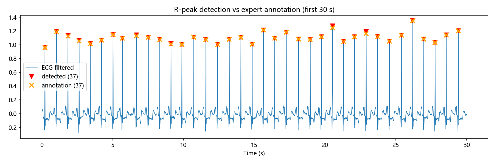

# ECG心电信号分析：R波检测 + HRV分析

基于MIT-BIH心律失常数据库(record 100)，用经典Pan-Tompkins算法
完成R波检测，并计算全套HRV心率变异性指标。

## 结果

| 指标 | 数值 |
|------|------|
| 灵敏度 Se | 【100.00】% |
| 阳性预测值 +P | 【100.00】% |
| R波定位误差 | 【1.9】±【0.4】ms |
| SDNN / RMSSD / pNN50 | 【】/【】/【】 |
| LF / HF / LF-HF | 【】/【】/【0.25】|
| **批量宏平均(48条)** | Se=92.11%±16.9 |
| **批量宏平均(48条)** | +P=99.89%±0.4 |

## 批量基准

对MIT-BIH全部48条记录运行完整管线（约11万拍）：
微平均 Se=92.04%，+P=99.89%（TP=100780, FP=114, FN=8714）。
每条明细见 `results/batch_summary.csv`（按Se升序，垫底记录对应
电极脱落/室早连发/严重噪声等已知难点，详见报告讨论）。
## 流程

1. **读取** record 100（360Hz，MIT-BIH）
2. **滤波** 0.5Hz高通 + 50Hz陷波 + 40Hz低通（零相位filtfilt）
3. **检测** Pan-Tompkins：带通→微分→平方→滑窗积分→阈值+不应期
4. **HRV** 时域(SDNN/RMSSD/pNN50) + Poincaré + 频域Welch(LF/HF)

## 运行

pip install -r requirements.txt
python main.py        # 输出指标 + results/四张图

## 结构

src/preprocess.py   滤波模块
src/detect.py       R波检测+评估
src/hrv.py          HRV指标
main.py             全流程入口

